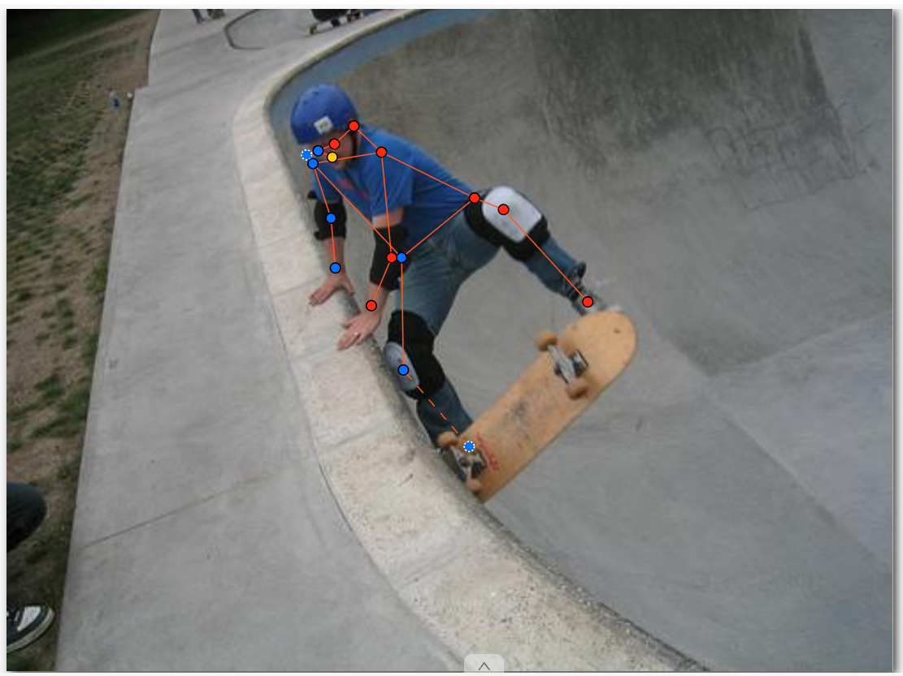
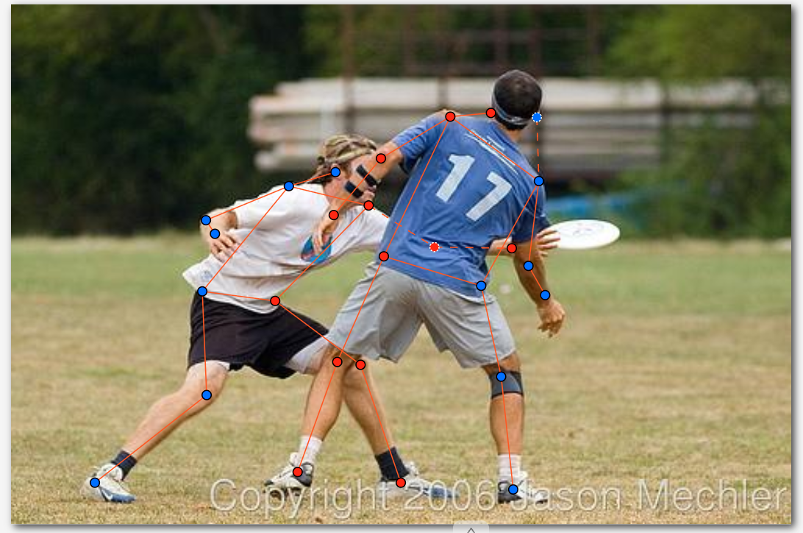
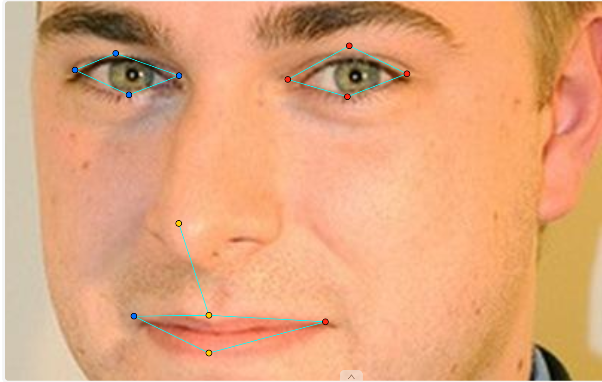
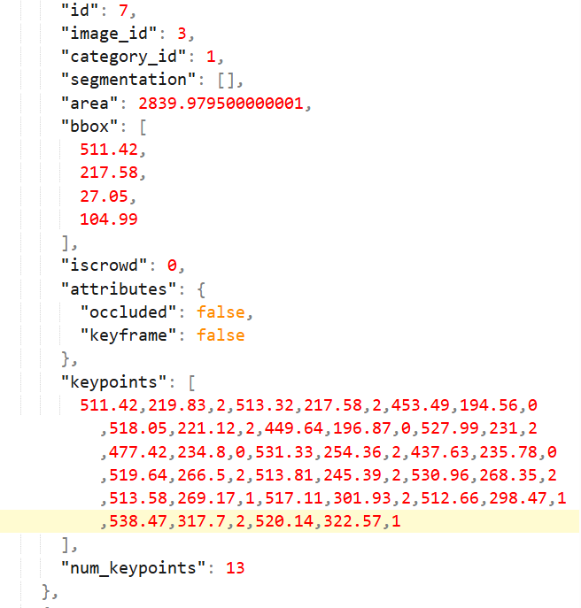

# Báo cáo cá nhân — Dương Quốc Huy-2A202603311

Dữ liệu: 12 ảnh người COCO 2017 (Lin et al., 2014) và 8 ảnh khuôn mặt cắt từ ảnh COCO 2017 (giấy phép CC BY / CC BY-SA), chỉ dùng trong lớp.

## 0. Thông tin học viên

- Họ tên: Dương Quốc Huy
- MSSV: 2A202603311
- Email: duongquochuy1107@gmail.com
- Link repository: https://github.com/dqhuy11/K5-L2B-DAY04-DuongQuocHuy-2A202603311-KeypointPose
- Phiên bản CVAT (Help → About): [ĐIỀN, ví dụ v2.x.x]
- Máy: hệ điều hành Windows 11 · RAM 16 GB · chạy CVAT chế độ đầy đủ
- Bộ ảnh (`src/exports/assignment.json` do `lab.py setup` tạo): có
- Giờ bắt đầu: 16h30 12/11/2026
- Giờ kết thúc: 12h 13/11/2026

## 1. Kiểm tra label (CP0)

| Label | Kiểu | Số điểm | Tên điểm đúng bảng của lab? | Đúng thứ tự? | Số cạnh |
|---|---|---:|---|---|---:|
| `person` | Skeleton | 17 | Có | Có | 19 |
| `face` | Skeleton | 13 | Có | Có | 13 |

Mẫu `person` dựng theo người quay mặt về camera (các điểm `left_*` nằm bên phải khung mẫu)? Có

Cách đổi cờ `occluded` / `outside` cho **một điểm** trên phiên bản CVAT này (một câu):

Em rê chuột vào đúng điểm cần đổi rồi bấm `Q` để bật `occluded` (`v = 1`) hoặc `O` để bật `outside` (`v = 0`); cũng có thể chuột phải vào điểm để mở menu có các nút outside · khóa · occluded · hidden. Khi đổi, chỉ điểm đó thay đổi: điểm `occluded` thành vòng rỗng, các cạnh nối tới nó thành nét đứt, còn điểm `outside` biến mất khỏi ảnh.

## 2. Số lượng đã gán và thời gian (CP1, CP2)

| Nhóm ảnh | Số ảnh | Số skeleton đã gán | Số người dưới 60 px (không gán) | Số poster / gương / màn hình bỏ qua | Thời gian (phút) |
|---|---:|---:|---:|---:|---:|
| `easy` | 5 | 5 | 0 | 0 | 30p |
| `occluded` | 3 | 5 | 0 | 0 | 30p |
| `back` | 2 | 4 | 0 | 0 | 30 |
| `small` | 1 | 2 | 0 | 0 | 30[ |
| `crowd` | 1 | 3 | 0 | 0 | 15p |
| `faces` | 8 | 8 | — | 0 | 15p |

Chi tiết số skeleton theo ảnh:
- `easy`: 000000308257 (1), 000000314154 (1), 000000455536 (1), 000000508269 (1), 000000525227 (1)
- `occluded`: 000000157271 (2), 000000183176 (1), 000000393909 (2)
- `back`: 000000043500 (2), 000000518966 (2)
- `small`: 000000106051 (2)
- `crowd`: 000000012552 (3)
- `faces`: 3 mặt thẳng (face_145751, face_232598, face_85624), 2 mặt nghiêng (face_415073, face_416730), 1 kính trong (face_81239), 1 kính râm (face_405456), 1 tóc che (face_333134), mỗi ảnh 1 skeleton.

Tổng cộng em gán 19 skeleton `person` trên 12 ảnh và 8 skeleton `face` trên 8 ảnh.

- Số ảnh người đã xong ở mốc phút 105: [ĐIỀN] / 10
- Thời gian thực tế (phút): CP1 [ĐIỀN] · CP2 [ĐIỀN] · CP3 [ĐIỀN]
- Ảnh tốn thời gian nhất là ảnh nào, vì sao?

[ĐIỀN: ví dụ 000000012552 (crowd, 3 người chồng lên nhau, trọng tài quay lưng, người bắt bóng ngồi xổm bị che nhiều khớp)]

## 3. Bảng ca khó (CP1, CP2)

> Em tự điền mục này từ job thật (theo RULES.md, AI không được viết hộ mục 3).

| Ảnh | Người / mặt | Điểm | Cờ đã chọn | Phân vân giữa | Lý do chọn |
|---|---|---|---:|---|---|
| | | | | | |
| | | | | | |
| | | | | | |

## 4. Bảng tự review (CP3)

> Em tự điền mục này từ job thật (theo RULES.md, AI không được viết hộ mục 4). Ba dòng đầu là ba ảnh script cảnh báo, em mở lại CVAT kiểm rồi ghi mã lỗi và ghi chú.

Đi từ ảnh cuối về ảnh đầu. 5 ảnh người (ít nhất 2 ảnh `back` hoặc `crowd`) và 3 ảnh mặt.

| Ảnh | Người / mặt | Điểm | Mã lỗi | Ghi chú | Đã sửa? |
|---|---|---|---|---|---|
| 000000012552 (crowd) | #1 | shoulder, wrist | | | |
| 000000508269 (easy) | #1 | knee, ankle | | | |
| 000000308257 (easy) | #1 | ankle | | | |
| | | | | | |
| | | | | | |
| | | | | | |
| | | | | | |
| | | | | | |

Tổng hợp số lỗi theo mã:

| `lr_swap` | `vis_flag` | `position` | `missing` | `extra` | `ok` |
|---:|---:|---:|---:|---:|---:|
| | | | | | |

Điểm còn phân vân giữa `v = 1` và `v = 0` (ghi cả hai lựa chọn và lý do chọn):

...

## 5. Kiểm file xuất và kết quả tự kiểm (CP4)

Tự kiểm tay trong file JSON:

| File | Người / mặt kiểm (ảnh, thứ tự) | Số phần tử `keypoints` | Điểm `outside` ra `v = 0`, `occluded` ra `v = 1`? | `num_keypoints` khớp? |
|---|---|---:|---|---|
| `DuongQuocHuy_persons.zip` | 000000043500, người #1 | 51 | Có | Có |
| `DuongQuocHuy_persons.zip` | 000000012552, người #3 | 51 | Có | Có |
| `DuongQuocHuy_faces.zip` | face_405456 (kính râm) | 39 | Có (4 điểm mắt sau kính ra `v = 1`) | Có |

Sau khi xuất, CVAT ghi `occluded` thành `v = 1` và `outside` thành `v = 0`. Tọa độ của điểm `outside` trong file là tọa độ cũ, không phải `0, 0` (CVAT 2.x xuất như vậy; điểm `v = 0` bị bỏ qua khi huấn luyện và khi chấm nên không ảnh hưởng).

Hai job đã chuyển sang completed trên CVAT? Có

Dán phần **TÓM TẮT** in ra từ `src/check_submission.py`:

```text
----- TÓM TẮT (dán vào báo cáo mục 5) -----
- File person: DuongQuocHuy_persons.zip
  Số ảnh: 12 · số skeleton `person`: 19 · mỗi annotation 51 số
  Skeleton theo ảnh: 000000012552=3, 000000043500=2, 000000106051=2, 000000157271=2, 000000183176=1, 000000308257=1, 000000314154=1, 000000393909=2, 000000455536=1, 000000508269=1, 000000518966=2, 000000525227=1
  Cờ v: v=2 220 (68%) · v=1 24 (7%) · v=0 79 (24%)
  num_keypoints trung bình: 12.8
- File face: DuongQuocHuy_faces.zip
  Số ảnh: 8 · số skeleton `face`: 8 · mỗi annotation 39 số
  Skeleton theo ảnh: face_145751=1, face_232598=1, face_333134=1, face_405456=1, face_415073=1, face_416730=1, face_81239=1, face_85624=1
  Cờ v: v=2 96 (92%) · v=1 8 (8%) · v=0 0 (0%)
  num_keypoints trung bình: 13.0
- Ghi chú: 79 điểm v = 0 vẫn mang tọa độ cũ (CVAT 2.x xuất như vậy; chuẩn COCO ghi 0, 0). Không phải lỗi: điểm v = 0 bị bỏ qua khi huấn luyện và khi chấm.
- Số [LỖI]: 0 · số [CẢNH BÁO]: 3
Kết quả: ĐẠT (đọc lại từng cảnh báo ở trên)
```

Các `[CẢNH BÁO]` còn giữ nguyên và lý do:

- `000000012552.jpg #1`: cặp shoulder, wrist nằm ngược phía so với các cặp còn lại. [ĐIỀN sau khi kiểm: ví dụ "Em đã kiểm lại, người này xoay thân khi vung gậy nên vai và cổ tay bắt chéo thật, giữ nguyên" hoặc "Là lr_swap, em đã sửa và xuất lại"]
- `000000308257.jpg #1`: cặp ankle nằm ngược phía. [ĐIỀN sau khi kiểm]
- `000000508269.jpg #1`: cặp knee, ankle nằm ngược phía. [ĐIỀN sau khi kiểm]

## 6. Ảnh chụp màn hình

1. Label `person` trong label constructor (đủ 17 điểm có tên):

   

2. Một người quay lưng đã gán, cờ đã đặt (trọng tài trong ảnh 000000012552, các cạnh nét đứt là điểm `occluded`):

   

3. Một khuôn mặt đã gán 13 điểm, phóng to vùng mắt:

   

4. Một đoạn JSON xuất của một người:

   

Nguồn ảnh: COCO 2017.

## 7. Tự đánh giá

> Em tự viết mục này (theo RULES.md, AI không được viết hộ mục 7).

1. Lỗi bạn mắc nhiều nhất hôm nay, và cách bạn sẽ tránh ở dự án thật:

   ...

2. Một quy tắc bạn đề xuất thêm vào guideline (kèm ảnh ví dụ nếu có):

   ...

3. Nhãn của bạn đi vào model ở đâu? Chọn một lỗi bạn đã sửa và nói nó sẽ làm model học sai thế nào (heatmap, trọng số trong loss, hay bước lật ảnh):

   ...

## 8. Khó khăn và lỗi kỹ thuật

- Em không gặp lỗi CVAT làm mất dữ liệu. `python lab.py export` xuất được cả hai file và script tự kiểm báo ĐẠT (0 lỗi, 3 cảnh báo).
- Em đã tạo task bonus nhưng không kịp gán xong nên không nộp phần bonus.
- [ĐIỀN thêm nếu có: CVAT chạy chậm, phải dùng `lab.py lite`, kẹt "Connecting…", ...]

## Bonus (nếu làm)

Em không làm phần bonus.

## 9. Tài liệu tham khảo và công cụ AI đã dùng

- Tài liệu của lab: `docs/GUIDELINE.md`, `docs/CVAT_CHEATSHEET.md`, `docs/COCO_KEYPOINTS.md`, `docs/HUONG_DAN_BANG_HINH.md`.
- Lin, T.-Y. et al. (2014). *Microsoft COCO: Common Objects in Context*. ECCV.
- Công cụ AI: Claude (Anthropic). Em dùng để hỏi các bước làm sau khi gán nhãn (export, nộp bài), giải thích kết quả `check_submission.py` và soạn khung báo cáo các mục 0, 1, 2, 5, 6, 8, 9. Các mục 3, 4, 7 em tự viết dựa trên job của mình.
